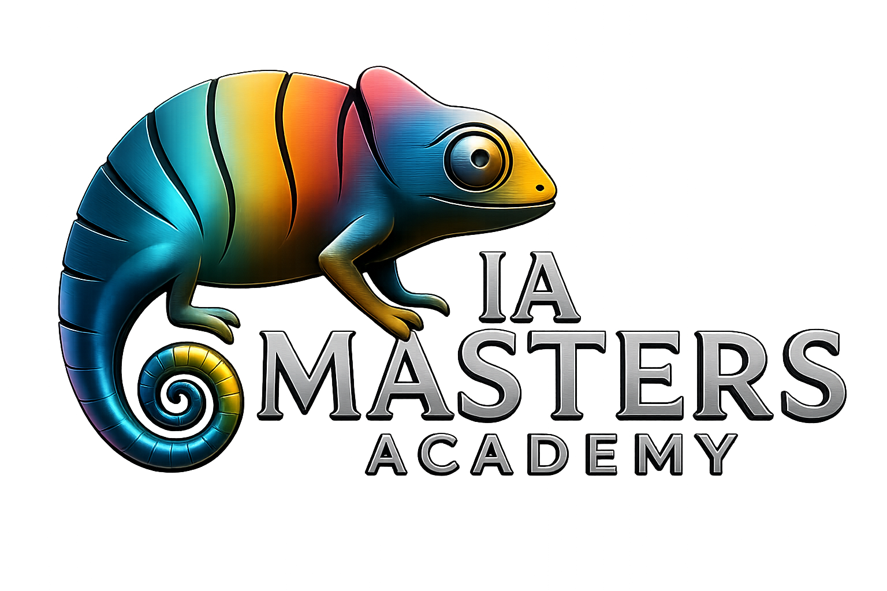

<p align="center">
  
</p>

<h1 align="center">iAmasters OS</h1>

<p align="center">
  <em>O sistema operativo agêntico para operadores de IA.<br>
  Português. Multi-cliente. Com memória que evolui.</em>
</p>

<p align="center">
  <a href="https://github.com/iamasters-academy/iamasters-os/releases"></a>
  <a href="LICENSE"></a>
  <a href="vendor/sinapsis/"></a>
  <a href="https://angelaparicio.com"></a>
  <a href="https://www.skool.com/ia-masters-automations"></a>
</p>

---

## 🚀 Instalação (v0.6 — com install gate)

**Caminho curto (recomendado)** — pelo terminal:

```bash
git clone https://github.com/iamasters-academy/iamasters-os.git ~/iamasters-os
cd ~/iamasters-os
bash scripts/install.sh
```

Isto instala as fases técnicas (prereqs + engine Sinapsis) com validação profunda. Quando terminar, abre o Claude Code nesta pasta e o resto completa-se por dentro:

1. O hook **SessionStart** detecta que faltam fases (onboarding + welcome) e guia o agente.
2. O agente invoca o comando `/install` que orquestra as 4 fases conversacionais restantes.
3. O **onboarding wizard** entrevista-te por sub-fases com **commits incrementais**: se interromperes a meio, o guardado fica guardado e `/install --resume` retoma exatamente onde paraste.
4. Após o wizard gera-se o teu primeiro entregável (`welcome-quick-win`, ~5 min).

Total realista: 15-20 minutos.

**Alguma coisa falha?** Executa:
```bash
bash scripts/install.sh --resume        # continua desde a última fase bem-sucedida
bash scripts/install.sh --force-reinstall  # backup do state atual e arranca limpo
```

E de dentro do Claude Code: `/install-status` mostra-te o dashboard sem tocar em nada.

> 💡 **Porquê este fluxo** (v0.6+): a versão anterior reportava por vezes "tudo instalado" quando partes tinham falhado silenciosamente. Agora há um **state machine persistente** em `~/.claude/skills/_install-state.json` que é a fonte da verdade sobre o que está realmente instalado. Validação profunda, não só presença de ficheiros. Ver [`docs/install-state-schema.md`](docs/install-state-schema.md).

Ainda não tens o Claude Desktop? [Descarrega aqui](https://claude.com/download). Não sabes que plano precisas? Ver [💰 Custo real](#-custo-real) abaixo.

---

## O que é

**iAmasters OS** é um repositório Claude Code que converte uma sessão vanilla num sistema operativo profissional para operadores de IA. Três camadas:

1. **Sinapsis v4.5 (engine)** — memória persistente, instintos auto-aprendidos, skills on-demand. Vendorizado intacto do [repo do Luis Pitik](https://github.com/Luispitik/sinapsis).
2. **Camada OS** — brand context (voice, positioning, ICP), agent context setorizado (me, work, team, priorities, goals), projetos estruturados, multi-cliente com templates por vertical.
3. **Skills curadas** — 23 skills validadas para marketing, estratégia, automação, tools, visualização e meta-pensamento. Todas seguem o padrão skill.md + references/ + scripts/. Skills oficiais da Anthropic (docx, xlsx, pdf, pptx) instalam-se via marketplace no dia 4 do `/aprende`.

> 🌱 **Sistema vivo**: o catálogo cresce com a comunidade. Quando uma skill nova da IA Masters Academy demonstra valor em produção, entra no repo. Ver [`docs/skills-recommended.md`](docs/skills-recommended.md) para propor uma.

## Para quem

- Operador IA freelancer que serve vários clientes
- Empreendedor que automatiza o seu negócio com Claude Code
- Agência pequena que quer padronizar a sua stack agêntica
- Formador que ensina Claude Code e precisa de um repo de referência
- Qualquer membro da [IA Masters Academy](https://www.skool.com/ia-masters-automations) (é a audiência principal)

Não requer conhecimentos de programação. Requer paciência para configurar pela primeira vez (~15-20 min de onboarding guiado).

## O que te dá no primeiro dia

- ✅ Memória que persiste entre sessões (acabou o "explica-me a tua stack outra vez")
- ✅ O teu primeiro entregável real gerado pelo sistema nos primeiros 20 min (welcome-quick-win)
- ✅ 23 skills curadas, instaladas, prontas a ativar-se quando falas com o Claude
- ✅ Brand context (voz, posicionamento, ICP) gerável em 30 minutos extra
- ✅ Multi-cliente pronto para escalar (4 templates de vertical incluídos)
- ✅ Sistema de aprendizagem contínua: o que repetes gradua-se a regra
- ✅ Decisions log append-only que mantém o Claude coerente entre sessões
- ✅ `/doctor` para diagnosticar e arranjar qualquer desvio

## 💰 Custo real

**Importante ler antes de instalar.** O iAmasters OS é grátis e open source, mas requer o Claude (da Anthropic), que NÃO é grátis.

| Conceito | Custo | Quando se paga |
|---|---|---|
| iAmasters OS (este repo) | **Grátis** (MIT) | Nunca |
| Membership iAmasters Academy | (ver site) | Se quiseres a comunidade e formação. **Não** é necessária para usar o OS |
| Claude Desktop app | Grátis (descarga) | Nunca |
| **Anthropic Pro** | **$20/mês** | Mínimo necessário para o OS funcionar bem |
| **Anthropic Max** | $100-200/mês | Se vais usar muito Cowork ou sessões longas de Code |
| Firecrawl API (opcional) | Grátis 500 créditos | Se quiseres que o OS faça scraping do teu site/LinkedIn auto |

**Conclusão**: o custo mínimo realista para começar bem é **$20/mês de Anthropic Pro**. Com o plano Free os modelos bons não chegam e o OS sente-se partido.

> Se vens da iAmasters Academy: a tua membership NÃO inclui Anthropic. São contas separadas. Dizemo-lo claro porque outros produtos escondem.

## Instalação alternativa (via Claude Code)

Se preferires lançar tudo a partir do Claude Code (não recomendado para v0.6 — o script técnico executa-se melhor do terminal):

```
Instala o iAmasters OS desde
https://github.com/iamasters-academy/iamasters-os
e guia-me no setup
```

O Claude Code vai clonar o repo e indicar-te abrir o terminal para executar `bash scripts/install.sh` (as fases técnicas precisam de terminal). Depois disso, o fluxo é o mesmo: o install gate guia as fases restantes.

Detalhe completo em [`docs/installation.md`](docs/installation.md) e schema do state machine em [`docs/install-state-schema.md`](docs/install-state-schema.md).

## Depois de instalar

O mais útil para arrancar:

| Comando / ação | O que faz |
|---|---|
| `/install` | Orquestra a instalação por fases. Reentrante com `--resume` (v0.6) |
| `/install-status` | Dashboard read-only do state machine (v0.6) |
| Onboarding wizard (auto) | Entrevista-te por sub-fases com commits incrementais |
| `/welcome` | Gera o teu primeiro entregável HTML partilhável (5 min) |
| `/doctor` | Diagnostica o OS com validação profunda, deteta drift, propõe fixes |
| `/start-here` | Ritual diário de início: resumo de ontem + proposta de hoje |
| `/wrap-up` | Ritual de fecho: regista deliverables, decisões, lições |

## Skills incluídas (Camada 1 — pré-instaladas)

```
_meta/                            Sistema e rituais do OS
├── meta-skill-creator            Cria skills novas seguindo o padrão canónico
├── meta-onboarding-wizard        Entrevista express adaptativa (8 dimensões críticas)
├── meta-deep-dive                🆕 Entrevista profunda adaptativa (22-25 dimensões)
├── meta-start-here               Ritual diário de início
├── meta-wrap-up                  Ritual diário de fecho
├── welcome-quick-win             O teu primeiro entregável garantido em 5 min
├── six-hats                      Método 6 chapéus de De Bono
├── decisions-log                 Diário append-only inspirado em second-brain
├── health-check                  Diagnóstico (via `/doctor`)
└── find-skills                   Descoberta por intent em linguagem natural

marketing/                        Voz, conteúdo e conversão
├── marketing-brand-voice         Voice profile + 3 registos A/B/C
├── marketing-positioning         Análise de posicionamento
├── marketing-icp                 Cliente ideal: dores, linguagem, triggers
├── marketing-copywriting         Copy com humanizer gate obrigatório
├── marketing-content-repurposing Distribuição multiplataforma
└── marketing-email-sequence      🆕 Sequências de email (welcome, nurture, win-back)

automation/                       🆕 Automação e migração
├── automation-n8n-to-claude      Migra workflows n8n para o ecossistema Claude
└── automation-n8n-builder        Cria workflows n8n desde o Claude (via MCP n8n-mcp)

strategy/                         🆕 Investigação e estratégia
└── strategy-web-research         Research profundo multi-fonte (LangChain)

tools/                            Utilidades transversais
├── tool-firecrawl-scraper        Wrapper Firecrawl com fallback manual
├── tool-humanizer                Remove padrões AI-tell do output
└── tool-output-verifier          Gate de qualidade (humanizer + voice + length)

visualization/                    Outputs partilháveis
└── tool-visual-explainer         Gera HTML autocontido partilhável

_meta/_optional/                  Ativáveis com `/install-skill <nome>`
└── cognito                       Sistema Operativo de Pensamento (Luis Pitik)
```

> 📦 **Skills oficiais Anthropic (`docx`, `xlsx`, `pdf`, `pptx`)**: NÃO são vendorizadas neste repo porque a licença é "source-available" (não permite redistribuição). Instalam-se via marketplace oficial dentro do Claude Code (`/plugin install anthropic-skills`). O comando `/aprende` dia 4 guia-te passo a passo.

Queres mais? Ver [`docs/skills-recommended.md`](docs/skills-recommended.md) — catálogo da Camada 2 instalável on-demand com `/install-skill`.

## Estrutura do repo

```
iamasters-os/
├── .claude/
│   ├── settings.json           # Hooks Sinapsis + permissões seguras por defeito
│   ├── commands/               # Slash commands do OS
│   └── skills/                 # 22 skills curadas por categoria
│
├── brand-context/              # A tua marca: voice, positioning, ICP, assets
├── context/                    # Contexto setorizado: me, work, team, priorities, goals
│   ├── me.md                   # Identidade
│   ├── work.md                 # Negócio e receita
│   ├── team.md                 # Equipa
│   ├── current-priorities.md   # Foco atual (muda mensalmente)
│   ├── goals.md                # Objetivos 12 meses
│   ├── decisions-log.md        # Decisões append-only
│   ├── learnings.md            # Feedback de skills
│   └── soul.md                 # Personalidade do agente
│
├── projects/                   # Outputs por skill ou por brief
│   └── welcome/                # O teu primeiro entregável vive aqui
│
├── clients/                    # Multi-cliente
│   └── _templates/             # 4 verticais: freelance-ia, agencia-marketing,
│                               #               formador-online, consultoria-b2b
│
├── docs/                       # Guias de instalação, multi-cliente, skills curadas
├── scripts/                    # install, update, add-client, validate-skill
└── vendor/
    └── sinapsis/               # Sinapsis v4.5 vendorizado (engine de memória)
```

## Diferencial vs vanilla Claude Code

| Sem OS | Com iAmasters OS |
|---|---|
| Cada sessão começa a explicar a tua stack | Sinapsis lembra-se e carrega skills relevantes |
| Skills soltas sem curadoria | 18 skills validadas para o teu avatar |
| Brand voice cada vez que escreves | Voice profile permanente com 3 registos A/B/C |
| Outputs sem gate de qualidade | `tool-output-verifier` antes de entregar |
| 1 cliente ou mistura-se tudo | Multi-cliente com templates por vertical |
| Sem aprendizagem | O que repetes 3+ sessões → regra automática |
| Sem coerência entre sessões | `decisions-log.md` mantém track record |
| Se algo parte, abandono | `/doctor` diagnostica e propõe fixes |

## Compatibilidade

- **Anthropic Plan**: Pro ou Max (Free não chega)
- **OS**: macOS, Linux, Windows (Git Bash ou WSL)
- **Requer**: Claude Code (incluído no Claude Desktop), Node.js 18+, Python 3.9+, Git
- **Opcional**: Firecrawl API key (para auto-extrair voice profile e brand assets)

## Roadmap

Ver [`CHANGELOG.md`](CHANGELOG.md) para histórico detalhado.

- **v0.1.0** ✅ esqueleto + Sinapsis vendorizado + meta-skills + brand-context flow
- **v0.2.0** ✅ skills marketing core + output-verifier + skill marketplace local
- **v0.3.0** ✅ multi-cliente + 4 templates verticais + update.sh com conflict resolution
- **v0.4.0** ✅ MCPs curados + atribuição (6 camadas)
- **v0.4.3** ✅ Plug-and-play (URL conversacional, /doctor, welcome quick-win, six-hats, decisions-log, setorização context)
- **v0.5.0** ✅ Sistema vivo + skills automation/email/strategy + comando `/aprende` (tour de 5 dias) + showcase pré-povoado + plugins Anthropic via marketplace
- **v0.6.0** ✅ **Install gate** com state machine persistente, validação profunda anti-"instalação fantasma", hook SessionStart, onboarding por sub-fases com commits incrementais, comandos `/install` e `/install-status`, deteção Python multi-plataforma
- **v0.7.0** — Skills nativas em português (meeting-notes, proposal-writer, youtube-transcript, linkedin-posts) reescritas com voice profile do operador
- **v1.0.0** — release pública estável + vídeos Loom integrados + landing em iamastersacademy.com/os

## 🌱 Sistema vivo

iAmasters OS **não é um produto fechado**. É um repositório que cresce com a comunidade IA Masters Academy.

Cada vez que um membro constrói uma skill que demonstra valor em produção (validada ≥2 semanas, útil para ≥3 avatares, sem dependências privadas), entra no catálogo na próxima release. Cada vez que uma skill fica obsoleta ou tem melhor substituto, sai.

**Como propor uma skill nova**: ver critérios e processo em [`docs/skills-recommended.md`](docs/skills-recommended.md) → secção "Como propor uma skill ao catálogo". O maintainer (Angel) revê, e as que passam entram na próxima release com crédito ao autor.

**Cadência esperada**: release menor a cada 4-6 semanas com skills validadas pela comunidade.

## Contribuir

iAmasters OS é código aberto sob MIT. Contribuições bem-vindas:

- Skills novas (seguindo o padrão em [`docs/skill-creation-guide.md`](docs/skill-creation-guide.md))
- Templates de cliente para novos verticais
- Melhorias à documentação
- Reportes de bugs em `/doctor` ou instalação

## Créditos

- **Sinapsis**: [Luis Pitik](https://github.com/Luispitik/sinapsis) — o engine de memória persistente
- **Padrão decisions-log**: inspirado em [`Luispitik/claude-code-second-brain`](https://github.com/Luispitik/claude-code-second-brain)
- **skill cognito**: original do Luis Pitik, copiada com autorização
- **find-skills, visual-explainer**: da suite Anthropic skills + comunidade
- **Brand Voice patterns A/B/C**: inspirado no Brand Voice Manual de Fernando Montero
- **6 chapéus**: método de Edward de Bono, domínio público

## Sobre o projeto

**iAmasters OS** é propriedade de **Angel Aparicio** e faz parte do ecossistema de produtos da **[IA Masters Academy](https://www.skool.com/ia-masters-automations)**, a comunidade de operadores de IA.

| | |
|---|---|
| **Autor e mantenedor** | Angel Aparicio |
| **Marca** | IA Masters Academy |
| **Empresa legal** | AASC Associates |
| **Site pessoal** | [angelaparicio.com](https://angelaparicio.com) |
| **LinkedIn** | [angel-aparicio92](https://www.linkedin.com/in/angel-aparicio92/) |
| **GitHub** | [@angelapaia](https://github.com/angelapaia) |
| **GitHub Org** | [@iamasters-academy](https://github.com/iamasters-academy) |
| **Comunidade** | [skool.com/ia-masters-automations](https://www.skool.com/ia-masters-automations) |
| **Email** | aaparicio@iamastersacademy.com |
| **Ano** | 2025-2026 |

### Como citar

Se usares o iAmasters OS no teu trabalho, projeto ou publicação, agradecemos a citação. Ver [`CITATION.cff`](CITATION.cff) para o formato estruturado. Referência rápida:

> Aparicio, A. (2025-2026). *iAmasters OS* [Software]. IA Masters Academy.
> https://github.com/iamasters-academy/iamasters-os

### Code ownership

Este repositório segue o modelo CODEOWNERS do GitHub. Qualquer PR requer review do proprietário. Ver [`.github/CODEOWNERS`](.github/CODEOWNERS) para o detalhe.

### Marca

"IA Masters Academy", "iAmasters OS" e o logo do camaleão são marcas registadas de **AASC Associates · Angel Aparicio**. O código-fonte publica-se sob licença MIT (uso/modificação livres), mas o uso da marca e dos logos requer autorização explícita por escrito.

Para uso da marca, contactar: aaparicio@iamastersacademy.com

## Licença

Código-fonte sob MIT — ver [LICENSE](LICENSE).
Componente vendorizado Sinapsis v4.5 conserva a sua licença "Source Available" original do Luis Pitik em [`vendor/sinapsis/LICENSE`](vendor/sinapsis/LICENSE).

---

<div align="center">
  
  <p><strong>Arckhé AI</strong></p>
</div>